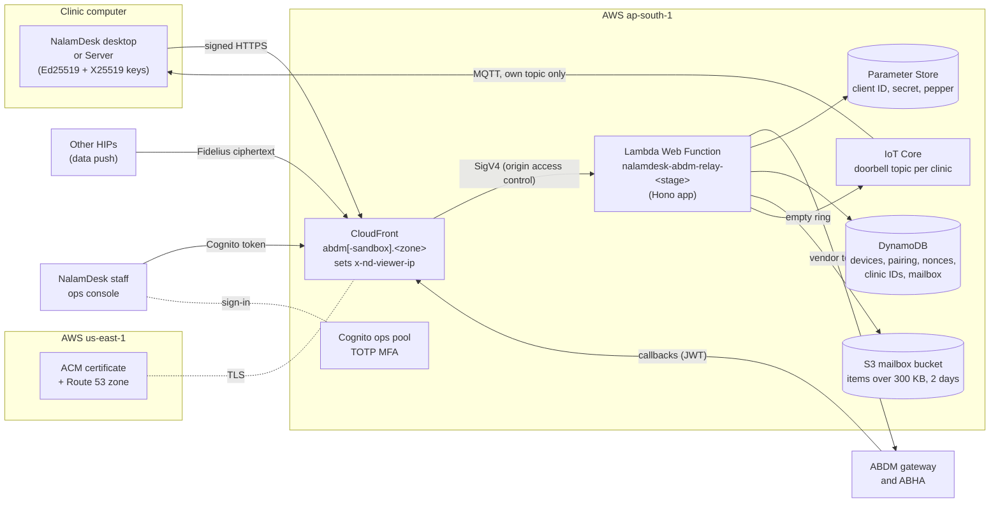
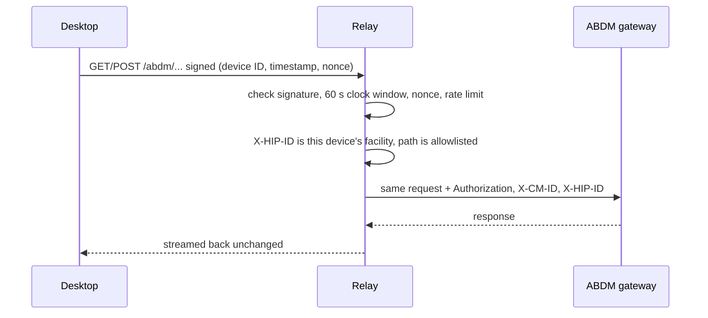
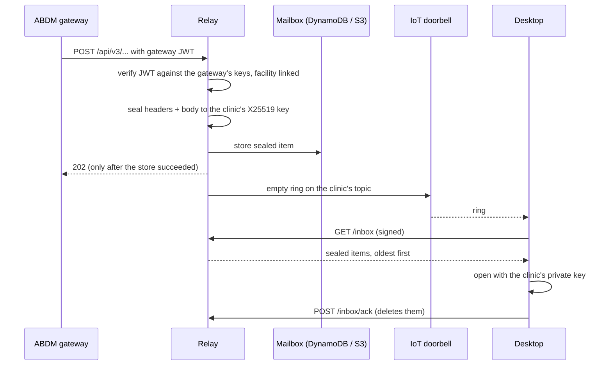
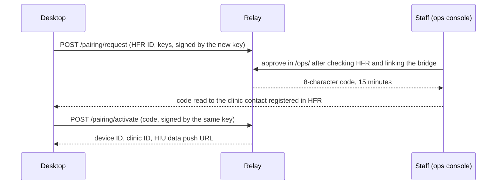
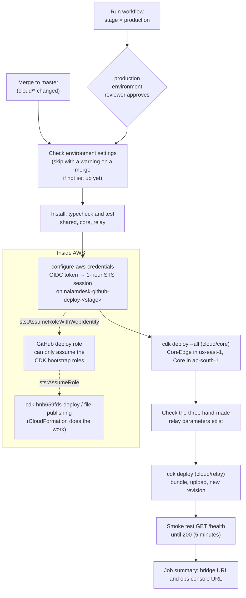

# NalamDesk Cloud relay: design and deployment

The relay is the one NalamDesk service that ABDM talks to. It holds the
vendor Client ID and secret, forwards signed calls from clinic desktops to
the ABDM gateway, and seals every callback to the clinic's own key before it
is stored. It never sees clinic data in the clear and keeps nothing beyond a
48-hour mailbox of sealed items. Code: [`cloud/relay`](../../cloud/relay/README.md)
(routes, pairing, sealing format) and [`cloud/core`](../../cloud/core/README.md)
(shared tables, auth, DNS). Issues #153 to #160.

## Goals and limits

- **Zero knowledge.** Callbacks and HIU data pushes are sealed (X25519,
  HKDF-SHA256, AES-256-GCM) to the clinic's sealing key on arrival. Only the
  paired desktop can open them. Logs hold metadata only.
- **No ABDM secret on clinic computers.** Desktops sign each request with a
  per-install Ed25519 key; the relay adds the gateway token.
- **One active desktop per clinic**, bound to its HFR ID, approved by
  NalamDesk staff (pairing, below).
- **Small and cheap.** One Lambda Web Function, DynamoDB on demand, a
  $10 monthly budget alarm. Region ap-south-1 (data stays in India); only
  certificates live in us-east-1 because CloudFront requires it.
- **Out of scope:** storing records, analytics, any path not on the
  allowlist (`src/allowlist.ts`).

## Components



| Piece | Why it is there |
| --- | --- |
| CloudFront | The public name and TLS. Its viewer function stamps the client IP for rate limits, and origin access control signs every request, so nothing but this distribution can call the function. |
| Lambda Web Function | The relay app (`src/server.ts`). Two environments and 64 concurrent requests each, because ABDM never resends a dropped callback. Until every adapter is wired it serves a 503 holding app (`src/bootstrap.ts`). |
| Parameter Store | The vendor credentials and the pairing-code pepper, as SecureStrings made by hand (CloudFormation cannot create them). |
| DynamoDB (Core) | Devices and their keys, pairing requests (24 h TTL), nonces (5 min TTL), the clinic ID per HFR ID, and the mailbox (48 h TTL). |
| IoT Core (Core) | The doorbell: an empty message on `nalamdesk/<stage>/clinic/<clinicId>/mail`. Each desktop has its own certificate from its own CSR and can only subscribe to its clinic's topic. |
| Cognito (Core) | Staff sign-in for the ops console, `ops` group, no self sign-up. |

## Request flows

### A desktop calls ABDM



### ABDM answers later (callback)



The desktop also fetches on connect and every 30 minutes, so a lost or
forged ring costs one fetch at most.

### Pairing a clinic



Details (rate limits, retries, revocation, key rotation):
[`cloud/relay/README.md`](../../cloud/relay/README.md#pairing).

## Stages

| Stage | Bridge URL | Deployed by |
| --- | --- | --- |
| `sandbox` | `https://abdm-sandbox.<zone>` | Every merge to master that touches `cloud/core`, `cloud/relay` or `cloud/shared`, or a manual run |
| `production` | `https://abdm.<zone>` | Manual run only, behind the `production` environment's reviewers |

Each stage has its own stacks (`NalamdeskCoreEdge-<stage>`,
`NalamdeskCore-<stage>`, `NalamdeskRelay-<stage>`), its own parameters under
`/nalamdesk/<stage>/` and its own GitHub environment and AWS role.

## Deployment pipeline

[`.github/workflows/deploy-cloud.yml`](../../.github/workflows/deploy-cloud.yml)
deploys with temporary credentials only. GitHub mints an OIDC token for the
job; AWS exchanges it for a one-hour session on a role that trusts only
jobs running in that stage's GitHub environment of this repository. No AWS
key is stored in GitHub.



Why this shape:

- **The GitHub role is thin.** It can only assume the CDK bootstrap roles
  and check that the relay parameters exist. CloudFormation acts through the
  bootstrap execution role, which the account admin controls.
- **Core before relay.** The relay reads Core's table, bucket and IoT names
  from Parameter Store at deploy time. An unchanged Core deploy is a no-op.
- **No cancelling.** Deploys of one stage queue; a cancelled CloudFormation
  update would roll back half way.
- **Health is checked, not assumed.** A revision can show Active while the
  app fails to start, and a relay missing an adapter answers 503 naming it.

## Desktop releases

Release builds stamp the relay address into `build-identity.json`
(`desktop/scripts/stamp-build-identity.js`), and the app reads it through
`getCloudServiceUrl('relay', ...)`. The Automated Release workflow and the
NalamDesk Server packages take it from the repository variable
**`NALAMDESK_RELAY_URL`**. Set it to the bridge URL of the stage clinics
should pair with: the sandbox URL while NHA sandbox registration is under
way, then the production URL. A release without it still builds, with a
warning, but cannot pair. For development, `NALAMDESK_RELAY_URL` in the
environment overrides the stamped value.

## One-time setup

Done once per AWS account, from a computer with admin credentials.

1. **Bootstrap CDK** in both regions:
   `npx cdk bootstrap aws://<account>/ap-south-1 aws://<account>/us-east-1`
2. **Create the GitHub deploy roles** from
   [`cloud/deploy/github-deploy-role.yaml`](../../cloud/deploy/github-deploy-role.yaml):
   ```sh
   aws cloudformation deploy --region ap-south-1 --stack-name nalamdesk-github-deploy \
     --template-file cloud/deploy/github-deploy-role.yaml --capabilities CAPABILITY_NAMED_IAM \
     --parameter-overrides GitHubRepo=nalamdesk/nalamdesk
   ```
   Add `CreateOidcProvider=false` if the account already has the GitHub
   OIDC provider. The outputs are the two role ARNs.
3. **Create the relay parameters** for each stage (see
   [`cloud/relay/README.md`](../../cloud/relay/README.md#infrastructure-infra)):
   `abdm-client-id`, `abdm-client-secret`, `pairing-pepper` under
   `/nalamdesk/<stage>/relay/`.
4. **DNS.** If the zone already exists in Route 53, set
   `NALAMDESK_HOSTED_ZONE_ID`. Otherwise the first Core deploy creates it and
   waits on certificate validation until the domain's NS records point at
   it, so make that first deploy by hand or delegate quickly.
5. **GitHub environments** `sandbox` and `production` (Settings →
   Environments), each with:

   | Name | Kind | Value |
   | --- | --- | --- |
   | `AWS_DEPLOY_ROLE_ARN` | secret | That stage's role ARN from step 2 |
   | `NALAMDESK_BUDGET_EMAIL` | secret | Where budget and IoT alarm emails go |
   | `NALAMDESK_ZONE_NAME` | variable | The DNS zone, such as `nalamdesk.com` |
   | `NALAMDESK_HOSTED_ZONE_ID` | variable, optional | Existing Route 53 zone ID |
   | `ABDM_GATEWAY_ISSUER` | variable, optional | Callback JWT `iss`, once NHA confirms it |

   Give `production` a required reviewer and limit it to the `master` branch.
6. **Repository variable** `NALAMDESK_RELAY_URL` for desktop releases.
7. After the first deploy: confirm the SNS email subscription, add staff to
   the ops pool (relay README), and register the bridge URL for the Client ID.

## Operating it

- **Logs:** `/aws/lambda/web/nalamdesk-abdm-relay-<stage>`, 30 days, metadata only.
- **Rollback:** re-run the workflow on an earlier commit (Run workflow →
  choose the ref), or revert the merge; each deploy pins the code by S3 version.
- **Rotating vendor credentials:** `aws ssm put-parameter --overwrite`. The
  relay caches them for 5 minutes, so no deploy is needed.
- **Costs:** the Core budget emails at $10 a month.
